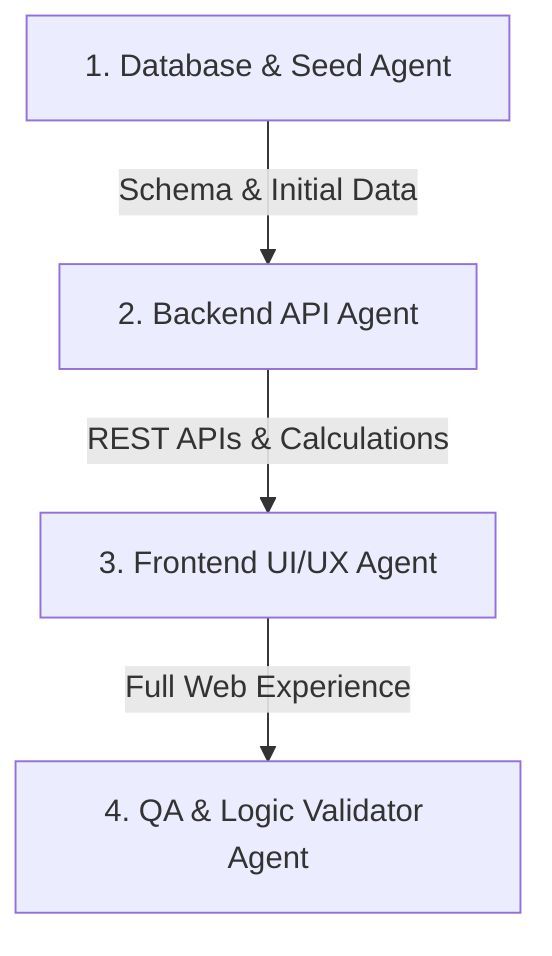

# AGENTS.MD - HỆ THỐNG QUẢN LÝ QUỸ, ĐIỂM DANH & LẬP LỊCH ĐỘI BÓNG (FC 6H CHỦ NHẬT)
> **Tài liệu đặc tả kỹ thuật và yêu cầu phát triển dành cho AI Agents / Developers để xây dựng Web Application chuyển đổi số hoàn chỉnh từ Google Sheets.**

---

## 1. MỤC TIÊU DỰ ÁN & CÁC YÊU CẦU NGHIỆP VỤ CỐT LÕI

Hệ thống được thiết kế theo đúng quy trình thực tế của Thủ quỹ / Đội trưởng đội bóng đá, giải quyết triệt để 7 bài toán:

1. **Quản lý Thành viên (CRUD đầy đủ)**:
   - Thêm thành viên mới (Họ tên, biệt danh, SĐT, số tiền nạp ban đầu nếu có).
   - Sửa thông tin thành viên (đổi tên, cập nhật số điện thoại).
   - Xóa thành viên (kèm xác nhận an toàn; cảnh báo nếu thành viên đã có dữ liệu trận đấu).
2. **Cộng tiền đóng trực tiếp theo từng trận**:
   - Thành viên nạp tiền quỹ thường đóng trực tiếp tại buổi đá.
   - Thủ quỹ nhập số tiền đóng thêm của thành viên ngay tại cột/ô của trận đó (cộng theo đúng số điền tay, ví dụ: +50k, +100k, +200k).
   - Hệ thống tự động cộng dồn số tiền này vào tổng tiền đã đóng của thành viên.
3. **Tự động tính số tiền thừa/thiếu & Đổi màu trực quan (Color Coding)**:
   - Công thức: `Số dư còn lại = Tổng tiền đã đóng (ban đầu + các trận) - Tổng tiền các trận đã tham gia`.
   - **Âm tiền (< 0đ)**: Tự động đổi màu **ĐỎ CẢNH BÁO** (chữ đỏ, nền đỏ nhạt, badge nổi bật) để dễ thấy ai đang nợ tiền sân.
   - **Dương tiền (> 0đ)**: Màu **XANH LÁ** (còn dư quỹ an tâm).
   - **Hết tiền (= 0đ)**: Màu **XÁM TRUNG TÍNH**.
4. **Bảng ma trận & Danh sách thu/chi từng trận**:
   - Hiển thị danh sách thành viên đối soát theo từng trận: ai đi đá, trận đó chi bao nhiêu tiền, trận đó nạp thêm bao nhiêu tiền.
   - Cho phép xem nhanh toàn bộ lịch sử đóng/dùng của từng thành viên.
5. **Bộ lập lịch thông minh cho các trận Chủ Nhật (Lịch Dương)**:
   - Mặc định tự động tính và gợi ý lịch các trận vào **Chủ Nhật hàng tuần** theo lịch Dương (khung giờ mặc định 6:00 - 7:30 sáng).
   - **Linh hoạt điều chỉnh**: Có thể dễ dàng đổi sang Thứ 7, ngày lễ hoặc đổi giờ đá bất kỳ lúc nào nếu có thay đổi đột xuất.
6. **Thống kê tức thì từng trận (Real-time Instant Totals)**:
   - Tự động đếm chính xác **Tổng số thành viên tham gia** trận đó.
   - Tự động cộng tổng **Tiền sân/tiền trận**, tổng **Tiền nạp thu thêm tại trận**.
   - Hỗ trợ nút tự chia đều tiền sân theo số người có mặt, hoặc nhập tiền tùy chỉnh từng người.
7. **Giao diện hiện đại, dễ nhìn & Cơ chế lưu trữ dữ liệu an toàn**:
   - Giao diện đẹp, trực quan, tối ưu cho cả **Điện thoại di động (Mobile 1-chạm)** và **Máy tính (Desktop dạng bảng lưới Google Sheets quen thuộc)**.
   - Tự động lưu (Auto-save) và có nút bấm "Lưu dữ liệu" hiển thị trạng thái đã lưu rõ ràng, không lo mất mát dữ liệu khi tải lại trang.
8. **Tách riêng Tiền Sân & Tiền Nước (Tính năng Tick Uống Nước +10k)**:
   - Thủ quỹ nhập riêng: **Tiền Sân** (VD: 300.000đ) và **Tiền Nước**.
   - Mỗi thành viên có 2 checkbox:
     - `[x] Đi đá`: Tham gia chia đều tiền sân (VD: 15 người đá = 20k/người).
     - `[x] Uống nước`: Ai ở lại uống nước thì tick vào -> hệ thống tự động cộng thêm đúng **+10.000đ** (hoặc chỉnh đơn giá nước tùy ý) vào chi phí trận của người đó. Ai về sớm không uống thì chỉ chịu đúng tiền sân (20k)!

---

## 2. THIẾT KẾ CƠ SỞ DỮ LIỆU (DATABASE SCHEMA)

Dự án sử dụng **Prisma ORM** với **SQLite** (chạy cục bộ ngay lập tức không cần cài đặt server nặng, có thể chuyển sang PostgreSQL/Supabase khi deploy cloud).

```prisma
// schema.prisma

datasource db {
  provider = "sqlite"
  url      = env("DATABASE_URL")
}

generator client {
  provider = "prisma-client-js"
}

// 1. Bảng Cầu thủ / Thành viên
model Player {
  id              String            @id @default(uuid())
  name            String            // Họ tên (VD: "Phi Đỗ", "Thành Kiên")
  nickname        String?           // Biệt danh (VD: "Dương dê", "Kiên bắc")
  phoneNumber     String?           // SĐT Zalo để gửi nhắc nợ
  initialDeposit  Float             @default(0) // Số tiền quỹ nạp ban đầu trước khi có hệ thống
  isActive        Boolean           @default(true) // Đang sinh hoạt hay tạm nghỉ
  displayOrder    Int               @default(0) // Thứ tự sắp xếp hiển thị
  createdAt       DateTime          @default(now())
  updatedAt       DateTime          @updatedAt

  matchRecords    MatchPlayerRecord[]
  deposits        DepositTransaction[]
}

// 2. Bảng Trận đấu
model Match {
  id              String            @id @default(uuid())
  matchDate       DateTime          // Ngày diễn ra (mặc định Chủ Nhật, lịch dương)
  title           String?           // Tên gợi nhớ (VD: "Trận CN 18/10")
  timeSlot        String            @default("06:00 - 07:30") // Giờ đá
  stadiumName     String?           @default("Sân bóng 6h50") // Địa điểm
  pitchFee        Float             @default(0) // Tiền thuê sân bóng (chia cho người đá)
  drinksFee       Float             @default(0) // Tiền nước uống (chia hoặc tính cho người ở lại uống)
  defaultDrinkPerPerson Float       @default(10000) // Đơn giá nước mặc định 10.000đ/người
  totalCost       Float             @default(0) // Tổng chi phí trận = pitchFee + drinksFee
  status          String            @default("SCHEDULED") // SCHEDULED | COMPLETED | CANCELLED
  notes           String?           // Ghi chú trận đấu
  createdAt       DateTime          @default(now())
  updatedAt       DateTime          @updatedAt

  records         MatchPlayerRecord[]
}

// 3. Chi tiết từng Cầu thủ trong từng Trận đấu (Quan trọng nhất)
model MatchPlayerRecord {
  id              String            @id @default(uuid())
  matchId         String
  playerId        String
  
  // Trạng thái tham gia
  isPresent       Boolean           @default(false) // Điểm danh: Có đá bóng hay không
  hasDrinks       Boolean           @default(false) // Điểm danh: Có ở lại uống nước không (+10k)
  drinkAmount     Float             @default(0)     // Tiền nước của riêng người này (mặc định 10.000đ khi tick)
  pitchShare      Float             @default(0)     // Tiền sân phần người này chịu (VD: 20.000đ)
  
  // Tổng tiền trừ cho trận này = pitchShare + drinkAmount
  feeCharged      Float             @default(0)     // Số tiền trận này phải chịu (VD: 20k đá hoặc 30k đá+nước)
  
  // TIỀN ĐÓNG THÊM TẠI TRẬN NÀY (Yêu cầu nghiệp vụ cốt lõi)
  addedDeposit    Float             @default(0)     // Tiền cầu thủ nạp thêm vào quỹ ngay trận này (VD: 100.000)
  
  note            String?                           // Ghi chú (VD: đá nửa hiệp, đóng qua Momo...)
  createdAt       DateTime          @default(now())
  updatedAt       DateTime          @updatedAt

  match           Match             @relation(fields: [matchId], references: [id], onDelete: Cascade)
  player          Player            @relation(fields: [playerId], references: [id], onDelete: Cascade)

  @@unique([matchId, playerId])
}

// 4. Lịch sử giao dịch nạp quỹ vãng lai ngoài trận (nếu có)
model DepositTransaction {
  id              String            @id @default(uuid())
  playerId        String
  amount          Float             // Số tiền nạp
  depositDate     DateTime          @default(now())
  note            String?           // VD: "CK ngân hàng ngày giữa tuần"
  createdAt       DateTime          @default(now())

  player          Player            @relation(fields: [playerId], references: [id], onDelete: Cascade)
}

// 5. Cấu hình đội bóng & VietQR nạp quỹ
model ClubConfig {
  id              String            @id @default("default")
  clubName        String            @default("FC 6H SÁNG CHỦ NHẬT")
  bankCode        String            @default("MB") // Ngân hàng (MB, VCB, TCB, VPB...)
  bankAccount     String            @default("0123456789")
  accountHolder   String            @default("NGUYEN VAN THU QUY")
  defaultTimeSlot String            @default("06:00 - 07:30")
}
```

---

## 3. LOGIC TÍNH TOÁN & CÔNG THỨC NGHIỆP VỤ (FINANCIAL ENGINE)

### 3.1. Tính số tiền của từng Thành viên
Đối với mỗi cầu thủ $i$:
1. **Tổng tiền đã đóng**:
   $$\text{TotalPaid}_i = \text{initialDeposit}_i + \sum_{\text{mọi trận}} (\text{addedDeposit}_{i, \text{match}}) + \sum (\text{depositTransaction}_i)$$
2. **Tổng tiền đã sử dụng (đã trừ)**:
   $$\text{TotalUsed}_i = \sum_{\text{mọi trận}} (\text{feeCharged}_{i, \text{match}})$$
3. **Số tiền thừa lại (Số dư / Balance)**:
   $$\text{Balance}_i = \text{TotalPaid}_i - \text{TotalUsed}_i$$
4. **Quy tắc hiển thị màu (Color Coding)**:
   - $\text{Balance}_i < 0$: **Đỏ Cảnh Báo** (`text-rose-600 bg-rose-50 border-rose-300`). Cần hiển thị nút bấm "Nhắc nợ / Mã QR đóng tiền".
   - $\text{Balance}_i > 0$: **Xanh Lá Tích Cực** (`text-emerald-700 bg-emerald-50 border-emerald-300`).
   - $\text{Balance}_i = 0$: **Xám Chuẩn** (`text-slate-600 bg-slate-100 border-slate-300`).

### 3.2. Tính toán tổng của từng Trận đấu
Đối với mỗi trận đấu $M$:
1. **Số thành viên tham gia**:
   $$\text{AttendingCount}_M = \sum [ \text{isPresent}_{i, M} == \text{true} ]$$
2. **Tổng tiền trận (Tổng chi phí các thành viên chịu)**:
   $$\text{TotalMatchFee}_M = \sum_{i} \text{feeCharged}_{i, M}$$
3. **Tổng tiền thu thêm tại trận**:
   $$\text{TotalAddedDeposit}_M = \sum_{i} \text{addedDeposit}_{i, M}$$
4. **Chia tiền tự động (Nút bấm 1-chạm)**:
   $$\text{Phí gợi ý mỗi người} = \text{Math.round}\left(\frac{\text{Tổng tiền sân thực tế}}{\text{AttendingCount}_M}\right)$$
   *(Vẫn cho phép sửa tay tiền của bất kỳ ai nếu đi nửa trận hoặc khách mời)*.

### 3.3. Thuật toán Lập lịch Chủ Nhật Hàng Tuần (Sunday Scheduler)
- Hệ thống có chức năng: **"Tạo trận Chủ Nhật tiếp theo"** hoặc **"Tự động sinh lịch 4 tuần kế tiếp"**:
  ```typescript
  // Hàm tìm ngày Chủ Nhật kế tiếp theo lịch Dương
  function getNextSunday(fromDate = new Date()): Date {
    const date = new Date(fromDate);
    const day = date.getDay(); // 0 là Chủ Nhật
    const diff = (7 - day) % 7 || 7;
    date.setDate(date.getDate() + diff);
    date.setHours(6, 0, 0, 0); // 6:00 sáng
    return date;
  }
  ```
- **Xử lý ngoại lệ**: Trên giao diện, mỗi trận đều có icon lịch (Date Picker) để thủ quỹ đổi sang Thứ 7 hoặc ngày bất kỳ chỉ với 2 click.

---

## 4. BỐ CỤC GIAO DIỆN & TRẢI NGHIỆM NGƯỜI DÙNG (UI/UX SPECIFICATION)

### 4.1. Giao diện Desktop (Bảng tính Thông minh kiểu Sheet Hiện Đại)
- **Thanh công cụ trên cùng (Toolbar)**:
  - Nút **+ Thêm Thành Viên** (Mở Modal).
  - Nút **+ Thêm Trận Đấu** (Mặc định chọn ngày Chủ Nhật tiếp theo).
  - Thẻ tóm tắt nhanh: `Tổng Quỹ Hiện Tại: 104.000đ` | `Số thành viên âm tiền: 4 người`.
  - Nút **"Lưu dữ liệu"** (Kèm icon trạng thái: *Đã lưu tự động* hoặc *Đang lưu...*).
  - Nút **"Xuất tin nhắn Zalo"** (Copy văn bản báo cáo quỹ nhanh).

- **Bảng Ma Trận Tổng Hợp**:
  | Họ & Tên | Đã đóng (Tổng) | Số dư còn lại | 19/9 (CN) | 27/9 (CN) | 4/10 (CN) | 11/10 (CN) | 18/10 (CN) | + Trận mới | Thao tác |
  | :--- | :---: | :---: | :---: | :---: | :---: | :---: | :---: | :---: | :---: |
  | **Phi Đỗ** | 74.000 | <span style="color:red;font-weight:bold;background:#fee2e2;padding:2px 6px;border-radius:4px">-10.000đ</span> | -22k | -10k | -22k | -20k | -10k *(+0k)* | [ + ] | [Sửa] [Xóa] |
  | **Thành Kiên** | 140.000 | <span style="color:green;font-weight:bold;background:#dcfce7;padding:2px 6px;border-radius:4px">+46.000đ</span> | -22k | -10k | -22k | -20k | -20k *(+50k)* | [ + ] | [Sửa] [Xóa] |
  | **Tổng trận** | **1.426k** | **+104k** | **308k (14 ng)** | **170k (17 ng)** | **254k (12 ng)** | **330k (17 ng)** | **260k (14 ng)** | ... | |

- **Tại mỗi ô của trận đấu**:
  - Gồm 2 trường nhập gọn gàng:
    - **Trừ tiền trận**: Số tiền trừ cho trận (VD: `20k`).
    - **Cộng tiền đóng thêm**: Ô nhỏ màu xanh `+ [ ... ]k` để thủ quỹ nhập ngay tiền thành viên đóng tại trận đó!

### 4.2. Giao diện Mobile (Tối ưu màn hình cảm ứng điện thoại)
- **Chế độ xem theo Thẻ (Card View)**:
  - Danh sách thành viên dạng Card, số dư to rõ, viền đỏ nổi bật nếu âm tiền.
  - Bấm vào tên để sửa/xóa hoặc xem lịch sử từng trận.
- **Màn hình Điểm Danh & Thu Tiền Trận Đấu (Match View)**:
  - Chọn trận đấu (VD: Trận Chủ Nhật 25/10).
  - Nhập tổng tiền sân (VD: `300.000đ`).
  - Danh sách cầu thủ dạng checkbox chạm nhanh:
    - [x] Phi Đỗ | Trừ: `20.000` | Thu thêm: `[ 50.000 ]`
    - [x] Thành Kiên | Trừ: `20.000` | Thu thêm: `[ 0 ]`
    - [ ] Chính (Vắng mặt)
  - Footer cố định dưới màn hình điện thoại:
    - Hiển thị: **"Đã chọn: 14 người | Tổng trừ: 280.000đ | Tổng thu thêm: 150.000đ"**
    - Nút lớn: **"LƯU KẾT QUẢ TRẬN"**.

---

## 5. CÁC API ENDPOINTS CẦN XÂY DỰNG

### 5.1. Quản lý Thành viên (Member API)
- `GET /api/players`: Lấy toàn bộ danh sách thành viên kèm tổng nạp, tổng chi, số dư còn lại.
- `POST /api/players`: Thêm mới thành viên `{ name, nickname, phoneNumber, initialDeposit }`.
- `PUT /api/players/[id]`: Cập nhật thông tin thành viên.
- `DELETE /api/players/[id]`: Xóa thành viên (nếu chưa có trận nào) hoặc ẩn (`isActive = false`).

### 5.2. Quản lý Trận đấu & Điểm danh (Match API)
- `GET /api/matches`: Lấy danh sách các trận đấu và thông số tổng hợp.
- `POST /api/matches`: Tạo trận đấu mới:
  - Hỗ trợ cờ `autoNextSunday: true` để hệ thống tự điền ngày Chủ Nhật tiếp theo.
  - Cho phép tùy chọn ngày bất kỳ `{ matchDate, timeSlot, stadiumName }`.
- `GET /api/matches/[id]`: Lấy chi tiết điểm danh, tiền trừ và tiền đóng thêm của từng thành viên trong trận.
- `PUT /api/matches/[id]`: Lưu điểm danh, tiền trừ và tiền đóng thêm của toàn bộ thành viên trong trận.
- `DELETE /api/matches/[id]`: Xóa trận đấu và hoàn lại số dư cho các thành viên.

### 5.3. Tiện ích Báo cáo & QR Ngân Hàng
- `GET /api/qr?playerId=[id]&amount=[amount]`: Sinh mã VietQR kèm số tài khoản thủ quỹ và cú pháp nạp tiền.
- `GET /api/report/zalo`: Trả về nội dung văn bản chuẩn bị sẵn để sao chép vào nhóm Zalo.

---

## 6. DỮ LIỆU GỐC BAN ĐẦU ĐỂ KHỞI TẠO (SEED DATA)

Dữ liệu gồm 25 thành viên và 5 trận đấu đã diễn ra (19/9, 27/9, 4/10, 11/10, 18/10), đã đối soát chính xác 100% tài chính:
- **Tổng tiền đóng**: `1.426.000đ`
- **Tổng tiền dùng**: `1.322.000đ`
- **Số dư hiện tại**: `+104.000đ`
- **4 thành viên âm quỹ**: Kiên bắc (-20k), Phi Đỗ (-10k), nguyên (-10k), duy (-10k).

*(Dữ liệu chi tiết đã được trích xuất hoàn chỉnh trong file `seed_data.json` ở thư mục gốc).*

---

## 7. KẾ HOẠCH & PHÂN CHIA NHIỆM VỤ CHO CÁC AI AGENTS



### 7.1. Agent 1: Database & Seed Data
- Khởi tạo Prisma ORM với SQLite.
- Thiết lập Schema với các thực thể: `Player`, `Match`, `MatchPlayerRecord`, `ClubConfig`.
- Viết script `prisma/seed.ts` nạp chính xác dữ liệu từ `seed_data.json` sao cho số dư ban đầu khớp đúng `+104.000đ`.

### 7.2. Agent 2: Backend & Calculation Engine
- Xây dựng các route handlers cho CRUD Player và Match.
- Cài đặt thuật toán tính `TotalPaid`, `TotalUsed`, `Balance`.
- Cài đặt logic cộng tiền nạp thêm theo từng trận (`addedDeposit`).
- Viết hàm gợi ý ngày Chủ Nhật tiếp theo tự động.

### 7.3. Agent 3: Frontend & Responsive UI
- Xây dựng giao diện với **Next.js (App Router)** và **Tailwind CSS**.
- Thiết kế 2 chế độ xem: **Bảng Ma trận (Sheet View)** cho máy tính và **Thẻ Điểm danh (Card View)** cho điện thoại.
- Thêm hiệu ứng màu sắc nổi bật cho số dư âm (màu đỏ) và số dư dương (màu xanh).
- Tích hợp Modal Thêm / Sửa / Xóa thành viên với thông báo toast mượt mà.
- Thêm nút Lưu dữ liệu kèm chỉ báo trạng thái lưu rõ ràng.

### 7.4. Agent 4: QA, Test & Bàn Giao
- Kiểm thử toàn diện:
  1. Thêm thành viên mới và kiểm tra xuất hiện trong tất cả các trận.
  2. Sửa tiền nạp thêm ở trận bất kỳ -> kiểm tra số dư còn lại tự động cộng dồn ngay.
  3. Kiểm tra tạo trận Chủ Nhật tự động và tính năng đổi ngày linh hoạt.
  4. Kiểm tra xóa trận hoặc xóa thành viên xem tính toàn vẹn dữ liệu.
